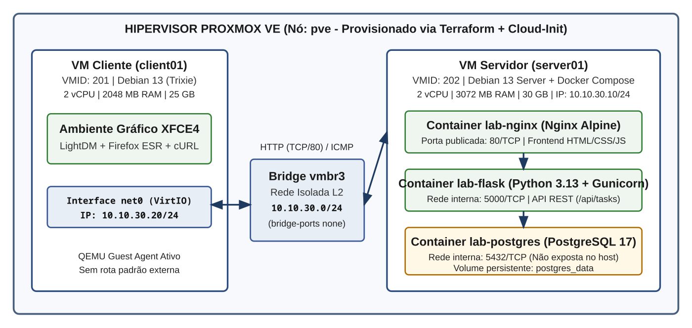

# Client-Server Web Environment

> Projeto acadêmico da pós-graduação em Tecnologias de Desenvolvimento Web (disciplina de Plataforma de Desenvolvimento em Software Livre e Servidores Web): implantação automatizada de um ambiente virtual cliente-servidor para desenvolvimento e execução de uma aplicação web completa utilizando ferramentas livres.

**Status:** concluído — infraestrutura provisionada, serviços em containers ativos e aplicação web validada em rede privada isolada.

## Objetivo

Construir e validar um ambiente cliente-servidor virtualizado no **Proxmox VE**, utilizando exclusivamente software livre, infraestrutura como código (**Terraform** + **Cloud-Init**) e containerização (**Docker Compose**). O projeto demonstra na prática a comunicação em camadas entre uma estação cliente gráfica (`client01`), um servidor web reverso (**Nginx**), uma API RESTful (**Flask** + **Gunicorn**) e um banco de dados relacional (**PostgreSQL**) operando em rede privada isolada (`vmbr3`).

## Arquitetura implementada

O ambiente é composto por duas máquinas virtuais Debian 13 (*Trixie*) conectadas a uma bridge privada no Proxmox VE (`vmbr3`), sem exposição à internet na configuração final:



| Componente | Identificação | Configuração implementada |
|---|---|---|
| **Hipervisor** | Proxmox VE (`pve`) | Host de virtualização KVM/QEMU |
| **Rede privada** | `vmbr3` | `10.10.30.0/24`, bridge isolada (`bridge-ports none`), sem gateway |
| **VM Cliente** | `client01` / VMID `201` | Debian 13 (2 vCPU, 2 GB RAM, 25 GB) com XFCE4, LightDM, Firefox ESR e `curl` (`10.10.30.20/24`) |
| **VM Servidor** | `server01` / VMID `202` | Debian 13 Server (2 vCPU, 3 GB RAM, 30 GB) com Docker Engine e Compose (`10.10.30.10/24`) |
| **Proxy Web / Frontend** | `lab-nginx` (`nginx:alpine`) | Servidor HTTP na porta `80`, servindo o frontend estático (`HTML5`/`CSS3`/`JS`) e proxy reverso para `/api/` |
| **Backend / API** | `lab-flask` (`python:3.13-slim`) | Aplicação Flask + SQLAlchemy + Gunicorn na porta interna `5000` (usuário não-root `appuser`) |
| **Banco de dados** | `lab-postgres` (`postgres:17-alpine`) | Persistência relacional na porta interna `5432` (não publicada no host) com volume `postgres_data` |
| **Provisionamento** | Terraform + Cloud-Init | Criação automatizada das VMs, usuários, pacotes e serviços no Proxmox (`bpg/proxmox`) |

O cliente acessa a aplicação pelo navegador em `http://10.10.30.10`. O Nginx entrega a interface web *Task Manager* e encaminha as chamadas `/api/tasks` ao backend Flask, que persiste os registros no PostgreSQL pela rede interna dos containers Docker.

Consulte [`docs/architecture.md`](docs/architecture.md), [`docs/network.md`](docs/network.md), [`docs/installation.md`](docs/installation.md) e [`docs/testing.md`](docs/testing.md) para os detalhes técnicos de cada camada.

## Funcionalidades da Aplicação (*Task Manager*)

A aplicação web implementa um gerenciador de tarefas com operações **CRUD** completas e endpoints de monitoramento de integridade (*healthchecks*):

- **`GET /`**: Interface web *Task Manager* servida pelo Nginx (HTML, CSS e JavaScript puro consumindo a API via `fetch`).
- **`GET /health`**: Verificação de integridade da aplicação Flask (`HTTP 200`).
- **`GET /health/db`**: Verificação ativa de conectividade com o PostgreSQL (`SELECT 1` via SQLAlchemy).
- **`GET /api/tasks`**: Listagem de todas as tarefas cadastradas ordenadas por identificador.
- **`GET /api/tasks/<id>`**: Consulta de uma tarefa específica.
- **`POST /api/tasks`**: Criação de nova tarefa com validação de título e status (`pending` ou `completed`).
- **`PUT /api/tasks/<id>`**: Atualização de título, descrição ou alternância de status (concluir/reabrir tarefa).
- **`DELETE /api/tasks/<id>`**: Exclusão permanente de uma tarefa.

## Organização do repositório

```text
client-server-web-lab/
├── README.md
├── .gitignore
├── infra/
│   └── terraform/
│       ├── versions.tf
│       ├── provider.tf
│       ├── variables.tf
│       ├── main.tf
│       ├── cloud-init.tf
│       ├── client.tf
│       ├── server.tf
│       ├── outputs.tf
│       ├── terraform.tfvars.example
│       └── cloud-init/
│           ├── client.yaml
│           └── server.yaml
├── frontend/
│   ├── index.html
│   ├── css/
│   │   └── style.css
│   └── js/
│       └── app.js
├── app/
│   ├── Dockerfile
│   ├── .dockerignore
│   ├── requirements.txt
│   ├── __init__.py
│   ├── extensions.py
│   ├── models.py
│   ├── routes.py
│   └── run.py
├── database/
│   └── init.sql
├── deploy/
│   ├── compose.yaml
│   ├── .env.example
│   └── nginx/
│       └── default.conf
└── docs/
    ├── architecture.md
    ├── network.md
    ├── installation.md
    ├── testing.md
    └── images/
        └── arquitetura_topologia.png
```

## Pré-requisitos do ambiente

- Servidor **Proxmox VE 8/9** operacional com a bridge privada `vmbr3` criada (`bridge-ports none`).
- **Terraform >= 1.6.0** com o provider `bpg/proxmox` (`~> 0.66.1`).
- Token de API do Proxmox e acesso SSH (`root@pve`) configurados para envio dos *snippets* Cloud-Init.
- Conectividade temporária via `vmbr0` (`temporary_internet_interface = true`) apenas durante o provisionamento inicial dos pacotes das VMs, alterada para `false` após a preparação para isolamento total na `vmbr3`.

### Configuração de acessos e permissões no Proxmox (Terraform)

Para que o provider `bpg/proxmox` autentique via API e SSH, baixe a imagem Cloud-Init, envie os *snippets* e provisione as VMs sem erros de permissão (`HTTP 403`) ou falha de handshake SSH:

1. **Acesso SSH ao nó Proxmox (para upload de *snippets* Cloud-Init):**
   O recurso `proxmox_virtual_environment_file` utiliza SFTP/SSH direto com o nó Proxmox (pois a API HTTP não suporta envio de *snippets*).
   - Autorize a chave pública SSH da estação de trabalho no usuário `root` do Proxmox:
     ```bash
     ssh-copy-id -i ~/.ssh/id_ed25519.pub root@<IP_DO_PROXMOX>
     ```
   - Certifique-se de que o storage de destino dos arquivos YAML (ex.: `HD-500GB` ou `local`) esteja com o tipo de conteúdo **Snippets** habilitado em *Datacenter -> Storage*.

2. **Extensão da imagem Cloud-Init (`.img` em vez de `.qcow2`):**
   Quando a imagem é baixada via `proxmox_virtual_environment_download_file` com `content_type = "iso"`, o Proxmox exige que o `file_name` salvo termine com a extensão **`.img`** (`debian-13-generic-amd64.img`) para permitir a importação posterior do disco nas VMs.

3. **Usuário, Token de API e Role de Permissões (ACLs):**
   No Proxmox VE 8+, quando o Token da API possui *Privilege Separation* (`privsep = 1`) ativado, os privilégios efetivos são a **interseção** entre as permissões do usuário e as do token. Além disso, atribuir duas roles diferentes separadamente no mesmo caminho (`/`) para o mesmo usuário sobrescreve a anterior. Por isso, todos os privilégios necessários de VM, Storage e Rede devem estar unificados na mesma Role e vinculados tanto ao usuário quanto ao token:
   ```bash
   # 1. Criar usuário e token (caso ainda não existam)
   pveum user add terraform@pam
   pveum user token add terraform@pam terraform --privsep 1

   # 2. Criar/atualizar a Role unificada com permissões de VM, Datastore e Rede
   pveum role add TerraformProvisionamento -privs "Datastore.Allocate,Datastore.AllocateSpace,Datastore.AllocateTemplate,Datastore.Audit,Pool.Allocate,SDN.Use,Sys.AccessNetwork,Sys.Audit,Sys.Console,Sys.Modify,Sys.PowerMgmt,VM.Allocate,VM.Audit,VM.Clone,VM.Config.CDROM,VM.Config.CPU,VM.Config.Cloudinit,VM.Config.Disk,VM.Config.HWType,VM.Config.Memory,VM.Config.Network,VM.Config.Options,VM.Migrate,VM.PowerMgmt"

   # 3. Caso a role já exista, apenas atualize os privilégios:
   pveum role modify TerraformProvisionamento -privs "Datastore.Allocate,Datastore.AllocateSpace,Datastore.AllocateTemplate,Datastore.Audit,Pool.Allocate,SDN.Use,Sys.AccessNetwork,Sys.Audit,Sys.Console,Sys.Modify,Sys.PowerMgmt,VM.Allocate,VM.Audit,VM.Clone,VM.Config.CDROM,VM.Config.CPU,VM.Config.Cloudinit,VM.Config.Disk,VM.Config.HWType,VM.Config.Memory,VM.Config.Network,VM.Config.Options,VM.Migrate,VM.PowerMgmt"

   # 4. Aplicar a Role na raiz (/) tanto para o usuário quanto para o token
   pveum acl modify / -user terraform@pam -role TerraformProvisionamento
   pveum acl modify / -token 'terraform@pam!terraform' -role TerraformProvisionamento
   ```

## Como reproduzir a implantação

### 1. Provisionamento da infraestrutura (Terraform)
```bash
cd infra/terraform
cp terraform.tfvars.example terraform.tfvars
# Edite terraform.tfvars com o endpoint, token, storage e hash de senha (openssl passwd -6)
terraform init
terraform plan
terraform apply
```

### 2. Implantação dos serviços no servidor (`server01`)
```bash
cd deploy
cp .env.example .env
# Edite .env definindo POSTGRES_DB, POSTGRES_USER e POSTGRES_PASSWORD
docker compose up -d --build
docker compose ps
```

### 3. Isolamento final da rede privada (`vmbr3`)
Após a conclusão do Cloud-Init e do build das imagens Docker no `server01`:
1. Altere `temporary_internet_interface = false` em `infra/terraform/terraform.tfvars`.
2. Execute `terraform apply` para remover a interface temporária `net1` (`vmbr0`) de ambas as VMs.
3. Acesse `http://10.10.30.10` pelo navegador Firefox ESR na `client01` (`10.10.30.20`).

## Segurança e informações sensíveis

- Nenhum token, senha, chave privada, arquivo `.tfstate` ou `.tfvars` real é versionado no Git (protegidos por [`.gitignore`](.gitignore)).
- O repositório disponibiliza apenas modelos de configuração sem segredos: [`infra/terraform/terraform.tfvars.example`](infra/terraform/terraform.tfvars.example) e [`deploy/.env.example`](deploy/.env.example).
- O container da aplicação Flask é executado sob usuário dedicado sem privilégios de superusuário (`appuser`).
- O banco de dados PostgreSQL e o servidor Gunicorn não expõem suas portas (`5432` e `5000`) para fora da rede interna do Docker Compose — apenas a porta `80` do proxy reverso Nginx é publicada na interface da VM servidor (`10.10.30.10`).

## Status do projeto

- [x] Definição do escopo e arquitetura cliente-servidor.
- [x] Inspeção de rede e criação da bridge privada `vmbr3` (`10.10.30.0/24`) no Proxmox.
- [x] Provisionamento automatizado das VMs `client01` (201) e `server01` (202) com Terraform e Cloud-Init.
- [x] Desenvolvimento da API RESTful em Flask + SQLAlchemy + PostgreSQL e interface web *Task Manager*.
- [x] Orquestração dos serviços Nginx, Flask e PostgreSQL com Docker Compose.
- [x] Validação dos testes de conectividade, CRUD, persistência em volume e isolamento de rede.
- [x] Documentação técnica concluída.
